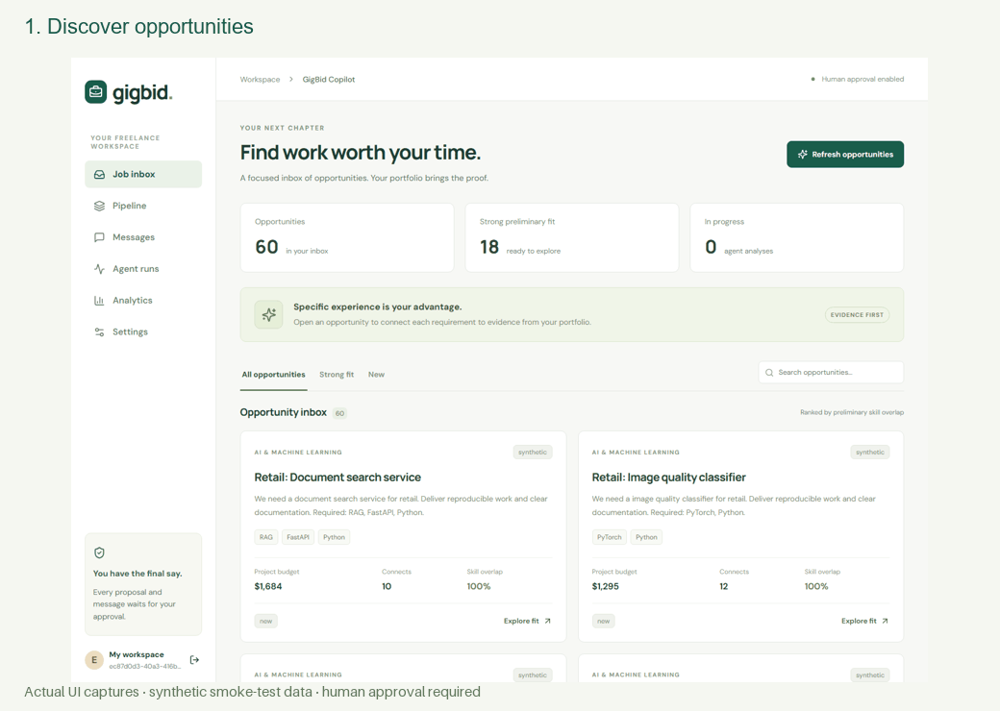
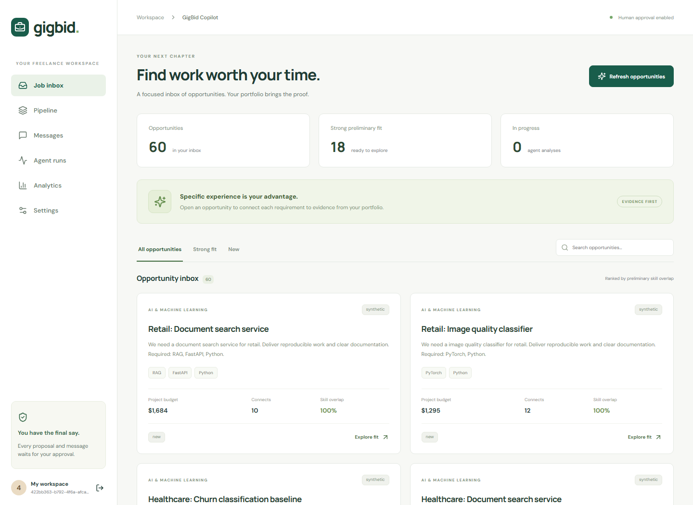
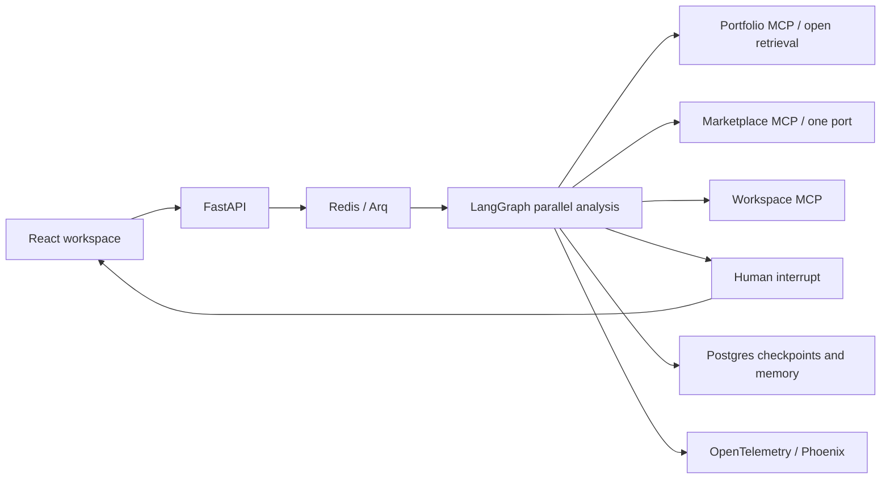

# GigBid



**Find worthwhile freelance work. Write proposals with proof. Approve every action.**

GigBid combines a React workspace, durable LangGraph workflows and three MCP
servers. Requirement-to-evidence matching, risk assessment, grounded drafting,
pricing and client replies stay visible and reviewable.

Source: [MominMunir/agentic-a2-0854](https://github.com/MominMunir/agentic-a2-0854).

**Live app:** [https://gigbid-wr80.onrender.com](https://gigbid-wr80.onrender.com) · [Portfolio MCP](https://gigbid-wr80.onrender.com/portfolio/mcp) (authenticated MCP endpoint).

Verified reviewer login, real-model drafting, scoped MCP and durable cloud storage: [deployment checks](evals/results/public_deployment.json).



## Run locally

```sh
git clone https://github.com/MominMunir/agentic-a2-0854.git
cd agentic-a2-0854
uv sync --frozen --extra dev --extra retrieval
uv run python scripts/bootstrap.py
uv run python scripts/generate_data.py
# Set OPEN_MODEL_API_KEY privately in .env (Groq open models), or select Ollama.
uv run python scripts/seed.py
docker compose up --build -d
```

Open http://localhost:8080. This is a local address, not a public deployment.
The full [runbook](docs/RUNBOOK.md) covers Windows development, local Ollama,
deployment, GitHub publication, recovery and secret handling.

## Architecture



See [architecture](docs/ARCHITECTURE.md), [tool contracts](docs/TOOLS.md),
[data provenance](docs/DATA_CARD.md), and [code-generated graph diagrams](docs/graphs).
The independent local simulator is explicitly separate from the missing
instructor GigSim. Live Upwork uses official MCP/OAuth and requires account/tool
mapping verification. No scraping or automatic platform confirmation is used.

## Retrieval results

| Variant | Recall@5 | MRR | nDCG@10 | Retrieval p95 (s) |
| --- | --- | --- | --- | --- |
| v0 | 0.996 | 1.000 | 0.999 | 0.040 |
| v1 | 1.000 | 1.000 | 1.000 | 0.096 |
| v2 | 0.310 | 0.667 | 0.592 | 0.041 |
| v3 | 0.204 | 0.984 | 0.567 | 0.287 |
| v4 | 0.259 | 0.635 | 0.505 | 0.030 |
| v8 | 0.310 | 0.667 | 0.592 | 0.032 |

Source: `evals/results/retrieval.json`, synthetic domain holdout. The development
selection rule chose **v0**. No human-panel or instructor outcome claim follows from these scores.

## Orchestration results

| Architecture | Attempted | Completed | Decision accuracy* | Unsupported before/draft | p95 (s) |
| --- | --- | --- | --- | --- | --- |
| react | 50 | 49 | 0.920 | 6.472 | 27.38 |
| supervisor | 50 | 1 | 0.020 | n/a (no drafts) | 0.24 |
| handwritten | 50 | 12 | 0.240 | n/a (no drafts) | 36.09 |
| handwritten_alt | 50 | 20 | 0.400 | 1.133 | 51.94 |

Source: `evals/results/orchestration.json`; actual Groq calls on synthetic jobs.
Read its sample size, completion counts and accuracy denominator before comparing
systems. Sequential groups encountered unequal daily token availability: 49 of 50
supervisor attempts were rejected by the quota. This cannot fairly rank architectures.
The p95 column includes failed attempts. No-draft claim rates are unavailable.
Provider failures are retained. Reply/hire rates require the unavailable
instructor simulator and are not invented. Actual USD figures are usage-based
public-price estimates, not an account invoice.

## Verify and reproduce

```sh
uv run python -m pytest -q
uv run python -m evaluation.run
uv run python -m evaluation.tool_study
uv run python -m evaluation.orchestration --limit 50
uv run python -m evaluation.agency_eval
cd apps/web
npm ci
npm run test:e2e
```

Raw metrics and logs: `evaluation/`. Summaries: `evals/results/`.
Current browser tests exercise onboarding/upload, approval, rejection, editing,
degraded mode and mobile layout. Model/API studies can be subject to quota limits.

## Deliverables and publication status

- [R&D report](docs/RnD_Report.md) and [PDF](output/pdf/RnD_Report.pdf)
- [Technical article](docs/Technical_Writeup.md), [three-minute script](docs/Demo_Script.md)
- [Standalone Portfolio MCP](mcp_servers/portfolio/README.md)
- [X1 agency extension](docs/EXTENSION.md) and [AI disclosure](docs/AI_USAGE.md)
- [Requirement ledger](docs/IMPLEMENTATION_PLAN.md)
- [Free Render deployment](docs/FREE_DEPLOYMENT.md) and [GitHub steps](docs/RUNBOOK.md#public-github-repository-steps-required-by-the-pdf)
- [Verified public deployment status](docs/DEPLOYMENT_STATUS.md)
- [Three saved workflow traces](docs/traces/README.md) and [resume bullets](docs/Resume_Bullets.md)

The source repository is public. See the live deployment status above and the
free deployment guide. Article/video publication remains pending. Reviewer
credentials are generated from environment variables, excluded from the release,
and shared privately. The assignment's published deadline has passed; no commit
dates are altered or represented as on time.
