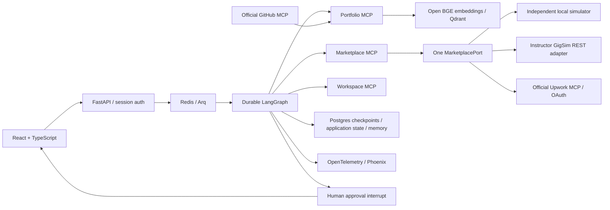
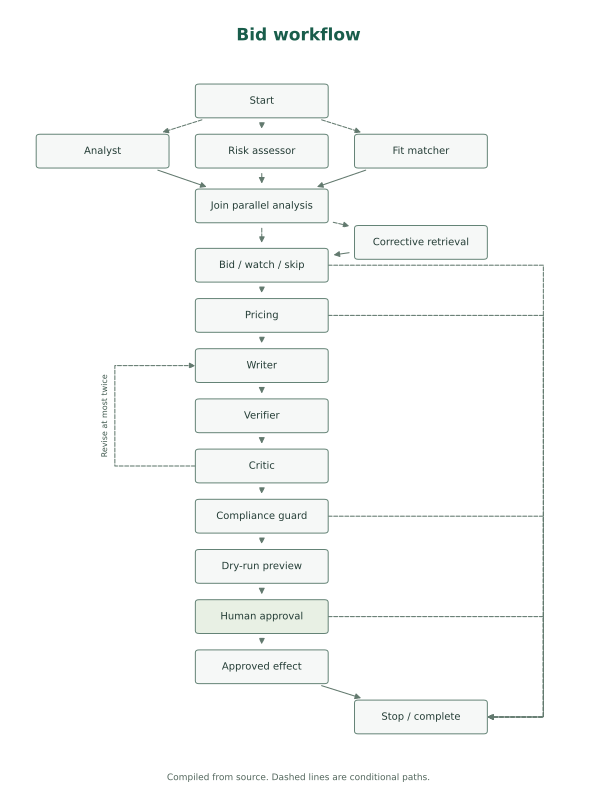
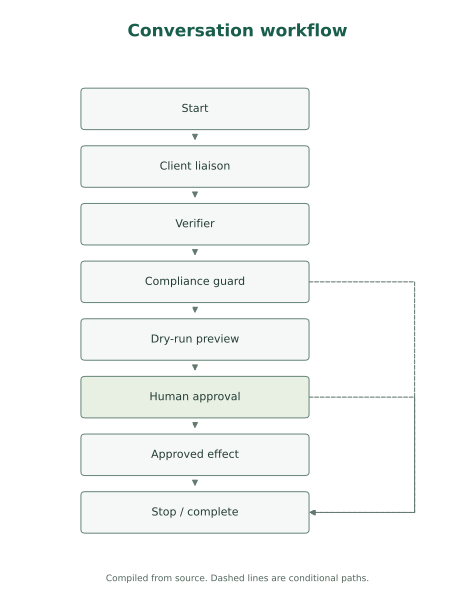

# GigBid architecture

The browser is a decision workspace. FastAPI authenticates users, accepts uploads,
queues work and persists human decisions. Redis/Arq owns scheduled scouting and
long runs. Agent nodes obtain marketplace, portfolio and calendar capabilities
only through MCP. The local developer executor is an explicit single-process
alternative; Compose always uses the Redis worker.

The bid graph uses `Send` to fan out Analyst, Risk Assessor and Fit Matcher.
Separate state keys avoid parallel write conflicts; usage and step fields have
additive reducers. A join waits for all branches. An optional V8 graph node
re-queries extracted requirements once when evidence is weak. Decision chooses
skip/watch/bid. Pricing enforces the user floor and Connects budget. Writer,
Verifier and Critic loop for an initial draft plus at most two revisions.
Compliance can block. A dry-run preview precedes `interrupt()`. Only an
authenticated human decision can mint the content-bound capability accepted by
the side-effect tool.

The conversation graph reads a thread, classifies question/negotiation/interview/
scam, suggests slots from a local calendar, verifies text and follows the same
approval/execute gate. It never accepts a contract or sends an invitation by
itself. Workspace write tools independently require explicit approval.

State, trace and long-term memory are separate. Checkpoints preserve job state
and pending interrupts; the append-only event/audit tables retain execution
observations; a durable LangGraph `BaseStore` holds only promoted style and
outcome records in tenant-specific namespaces. Three distinct outcomes are
required for an outcome aggregate. Style promotion requires five edit
observations and repeated deletion in three edits. Raw tool output never enters
memory. The Settings screen supports inspection and deletion.

Local SQLite is a development option. Production uses Postgres for both the
application database and `AsyncPostgresSaver`. The local simulator commits its
idempotency ledger, wallet debit and proposal/message in one transaction. A
reused idempotency key with changed content fails. This proves local exactly-once
effects; an external provider must uphold its own idempotency contract, and
ambiguous live failures require reconciliation.

Graph source diagrams are exported to `docs/graphs/` by `scripts/build_docs.py`.

## Decision records

- CPU BGE embeddings and FlashRank cross-encoder keep retrieval open and runnable
  without a GPU. The production vector index is Qdrant; NumPy cosine is the local
  reference implementation over the same vectors.
- The synthetic development split selects the deployed retriever. Its results
  do not establish generalization to unseen instructor corpora.
- Hosted Groq open weights are the user's selected model backend. A separate
  Ollama profile supports running without paid inference.
- Live schemas are discovered and explicitly mapped. Missing upstream assets or
  account access produce a visible connection/configuration error, never a fake
  successful integration.
