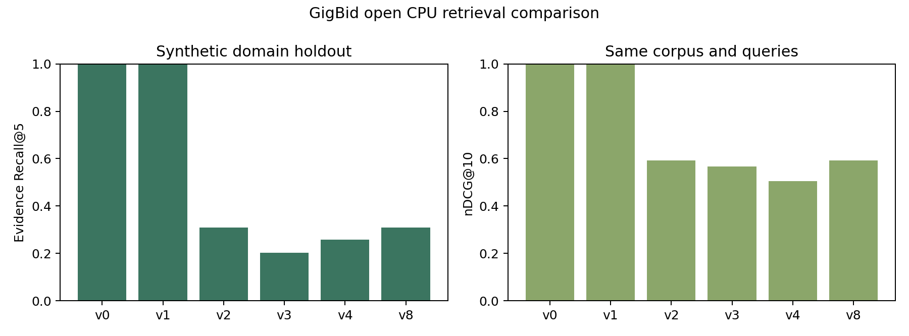

# GigBid R&D report
Engineering design review | 2026-11-15 | original implementation

## 1. Problem, constraints and evidence boundaries

GigBid assists job discovery, risk assessment, fit matching, pricing, proposal writing and client conversations. A freelancer retains authority over every outgoing proposal/message and every Connects debit. The objective is a useful decision workspace with grounded evidence, rather than an unconstrained text generator.

Declared budgets, registered before experiments: analysis p95 <=60 s, proposal p95 <=120 s, <=12,000 tokens and <=35 graph steps per thread, at most two Writer revisions, USD 0.05/job and USD 0.10/proposal for inference. USD figures in this report are estimates from actual returned token usage and configured public list prices; they are not the account invoice. Quota delays are included in run latency.

The workspace supplied a reference scaffold and assignment PDF, but no instructor GigSim service/package, full personas, dev labels, hidden set or November 2 policy update. The user confirmed these were not available. This implementation therefore separates historical Kaggle jobs from original synthetic portfolios and a local rule-based simulator. No local reply is labeled as an instructor or real-client outcome.

The implementation began on November 15, 2026. The owner confirmed that the original November 12 PDF deadline was extended to midnight PKT at the end of November 15. Commit timestamps remain unaltered. No human panel, hidden-test result or recorded demo is fabricated. This report distinguishes measured local behavior and subsequent deployment checks from unavailable external evaluations. Public deployment verified at https://gigbid-wr80.onrender.com; authenticated Portfolio MCP at https://gigbid-wr80.onrender.com/portfolio/mcp. Reviewer login, an actual open-model draft awaiting approval, scoped HTTP MCP, Neon checkpoint storage and Qdrant access are recorded in evals/results/public_deployment.json. This verifies one synthetic workflow, not uptime or hiring outcomes.

Reproducibility: evaluation/raw contains per-query and per-run observations; evals/results contains committed summaries. Source-specific SHA-256 hashes, provenance, software versions and selection rules accompany retrieval results. The report generator reads these files directly. docs/IMPLEMENTATION_PLAN.md records the requirement map and hypotheses before code/experiments.

## 2. Architecture and R&D A: capability design

React/TypeScript calls authenticated FastAPI endpoints. Redis/Arq runs scouting and graph work outside web requests. Analyst, Risk Assessor and Fit Matcher run with LangGraph Send and join before decision. Pricing, Writer, claim Verifier, bounded Critic and Compliance follow. A second graph handles conversations. The code-derived diagrams are docs/graphs/bid.mmd and conversation.mmd.

Portfolio MCP exposes read-only evidence search, full items, skills, resources and a prompt. Marketplace MCP owns the single port and adapters. Workspace MCP exposes local slots, tentative holds and email drafts. Every write has constrained input, dry run, an idempotency key and a user/action/content-bound approval capability. Per-role tool allowlists constrain access. Official Upwork and GitHub are the only remote service integrations; both require account verification.

H-A: focused rewritten tool descriptions improve exact selection over an ambiguous/coarse surface. Forty balanced known-call tasks were evaluated under fine, coarse and rewritten toolsets using actual Groq inference. Each toolset was assessed as one batch, so tokens/task are amortized, not independently timed task costs. Selection and argument accuracy are separate.

| Toolset | n | Selection | Arguments | Tokens/task |
| --- | --- | --- | --- | --- |
| fine | 40 | 1.000 | 1.000 | 50.4 |
| coarse | 40 | 1.000 | 1.000 | 55.5 |
| rewritten | 40 | 1.000 | 0.800 | 52.8 |

Source: evals/results/tool_study.json and evaluation/raw/tool_study.jsonl. Rewritten prose did not improve selection and reduced exact argument accuracy on these tasks. This is a negative result on a small, templated workload; it does not establish a general ranking of tool interfaces. The production surface retains explicit, focused tool schemas and names.

## 3. Data engineering and RAG methods

Two approved Kaggle sources contribute 1000 normalized fixed-price historical jobs. The import scans the original CSV members, validates descriptions, recognizes relevant skills, deduplicates normalized text and retains source row/URL/date/license. Hourly records are not converted into invented fixed budgets. Raw and normalized real text are excluded from release; the manifest, downloader and preprocessing code reproduce it.

| Source | Metadata license | Scanned | Retained |
| --- | --- | --- | --- |
| ahmedmyalo/upwork-freelance-jobs-60k | Apache 2.0 | 63950 | 500 |
| asaniczka/upwork-job-postings-dataset-2024-50k-records | ODC Attribution License (ODC-By) | 53058 | 500 |

Original seed-4016 synthetic data contains 330 evidence items, 180 jobs, plus tagged clients, reviews, proposal histories and conversations. All evidence carries persona/type/project/skills/date/industry/outcome/source/provenance. Real, synthetic and user-upload records have distinct tags and file locations. Full rationale, licensing caveats and limitations are in docs/DATA_CARD.md.

PDF/text/Markdown/JSON/code ingestion uses stable content-hash chunks and incremental updates. GitHub file ingestion uses official read-only MCP. BGE-small supplies open CPU dense embeddings; FlashRank MiniLM is the open cross-encoder. Qdrant serves production vectors, and NumPy cosine is the local reference backend. All evaluated variants share identical document headers with title, skills and industry.

Implemented variants: V0 fixed-document dense cosine; V1 requirement/query decomposition and merge; V2 BM25+dense reciprocal rank fusion; V3 cross-encoder over hybrid candidates; V4 outcome boost; V8 bounded corrective retrieval, with a graph-level re-query/refusal path. H-B predicted improved evidence recall from decomposition/fusion. The split is by industry: four development domains and two holdout domains. Template-generated relevance is not an independent human gold set.

## 4. R&D B: retrieval and grounding results

| Variant | Recall@5 | MRR | nDCG@10 | p95 s |
| --- | --- | --- | --- | --- |
| v0 | 0.996 | 1.000 | 0.999 | 0.040 |
| v1 | 1.000 | 1.000 | 1.000 | 0.096 |
| v2 | 0.310 | 0.667 | 0.592 | 0.041 |
| v3 | 0.204 | 0.984 | 0.567 | 0.287 |
| v4 | 0.259 | 0.635 | 0.505 | 0.030 |
| v8 | 0.310 | 0.667 | 0.592 | 0.032 |

Source: evals/results/retrieval.json; 180 frozen synthetic queries across three personas and six variants. Selection uses development Recall@5, then nDCG@10, then lower p95; the holdout never selects the winner. The rule chose v0, which is the deployed default. Per-persona results and job types remain in the raw files.

The advanced stages failed to improve this corpus. Shared project prose makes industry metadata unusually decisive. RRF can elevate exact technical matches from the wrong industry; the current reranker sees passage text without all initial metadata. Outcome boosts can prefer a successful but contextually wrong item. These are plausible failure mechanisms visible in rankings, not proof of general inferiority. V1/V2/V3/V4/V8 provide component-removal comparisons; a factorial independently labeled ablation remains future work.

After drafting, sentences are split and classified supported/partly-supported/unsupported. Experience needs an exact cited source passage; altered numbers, invented tenure and unknown citations fail. Unsupported text is removed before Critic, with counts retained. Five adversarial claim challenges are recorded in evals/results/claim_challenge.json. A zero post-filter unsupported rate must be read beside removed content and usefulness; this conservative verifier is not a semantic entailment oracle.

Independent human proposal ratings, a 30-item human/judge calibration and instructor reply/hire rates are unavailable. evaluation/human_panel.py prepares blinded packets, computes Cohen kappa only after at least 30 supplied paired labels, and calculates pairwise statistics. It never fills human columns with model guesses. A calibrated judge score is therefore not claimed.

## 5. R&D C: orchestration and model profiles

H-C predicts that isolated roles reduce unsupported claims/compliance failures relative to one ReAct agent, with extra latency and tokens. The runner compares an actual prebuilt ReAct agent, langgraph-supervisor and the handwritten graph on the same development jobs. A second handwritten profile uses gpt-oss-20b for both tiers; the primary profile uses 20b for cheap nodes and 120b for writing/critique. Tool responses, prompts, no-write constraints and common post-verification are explicit.

| Architecture | Tried | Done | Accuracy* | Raw claims | p95 s |
| --- | --- | --- | --- | --- | --- |
| react | 50 | 49 | 0.920 | 6.47 | 27.4 |
| supervisor | 50 | 1 | 0.020 | n/a | 0.2 |
| handwritten | 50 | 12 | 0.240 | n/a | 36.1 |
| handwritten_alt | 50 | 20 | 0.400 | 1.13 | 51.9 |

Source: evals/results/orchestration.json and evaluation/raw/orchestration.jsonl. Requested jobs per architecture: 50. Failed attempts are retained. Accuracy denominator is documented in the source summary; completion rate must be assessed alongside accuracy on successful runs. Tokens and cost are actual returned usage for completed calls. Provider errors may omit partial usage, so failed-call cost is unknown rather than zero.

Groq daily quotas caused 49/50 supervisor failures and most graph failures. Sequential groups had unequal token availability, so this operational study cannot fairly rank architectures or confirm H-C. The table p95 includes all attempts, including fast rejections; completed/proposal p95 are separate JSON fields. n/a means no drafts, not zero unsupported claims. Models are open-weight; CPU retrieval remains local and open.

| Architecture | Drafts | Mean tokens / done | USD total* | Analysis p95 s | Draft p95 s |
| --- | --- | --- | --- | --- | --- |
| react | 36 | 3491 | 0.03178 | n/a | 27.6 |
| supervisor | 0 | 2055 | 0.00050 | n/a | n/a |
| handwritten | 0 | 1457 | 0.00210 | 5.7 | n/a |
| handwritten_alt | 15 | 4778 | 0.01038 | 11.0 | 71.8 |

*USD totals cover returned usage on completed jobs only; failed-call usage is unknown. Baseline prices were derived from preserved token counts and recorded model IDs. Analysis time is measured through decision, and draft latency through the approval/terminal state. Network/retry latency is included; these are client observations, not server decoding tokens/second. Budget enforcement blocks writes after returned usage exceeds limits; a request may cross a budget before its usage is known.

No instructor GigSim service means no simulated reply/hire comparison can be completed, and no hidden test has been run. The local simulator deliberately generates a sample reply for UI exercises; counting it as a research reply rate would be invalid. The production decision is justified by tested control boundaries and available evidence, with generalization and outcome claims left open.

## 6. Reliability, security and production engineering

State, execution trace and long-term memory use distinct stores. Postgres checkpoints preserve interrupts. Event/audit rows record redacted observations. A durable LangGraph BaseStore separates tenant-specific style/outcome namespaces. Style promotion requires five edit observations with a deletion repeated in at least three; outcome aggregation requires three distinct confirmed jobs. Settings exposes deletion. Raw tool output is never promoted directly.

The approval endpoint rechecks edited text, mints an expiring content-bound capability and queues graph resumption. The graph rechecks again. The local simulator atomically commits its effect ledger, wallet debit and proposal/message. Duplicate calls with the same content return the original result; changed content under the same key fails. Unit/integration tests reopen the on-disk checkpointer and verify one debit after retry. External exactly-once effects require an upstream idempotency contract and reconciliation after ambiguous failures.

Job posts/messages are delimited untrusted data. Deterministic injection/off-platform/free-work rules supplement model risk. Agents cannot mint approval tokens. PII is masked in logs; OAuth tokens are encrypted and scoped by user. The HTTP MCP endpoint requires tenant bearer authentication. API sessions use HttpOnly/SameSite cookies, origin checks, constrained uploads and tenant ownership checks. Local rate-limit and outage handling are explicit. Rule-level injection routing is measured; a broad model attack-success claim is not made.

CI includes tests, schema snapshots, secret/instructor-directory gates and a 30-job deterministic smoke eval. Playwright verifies six browser journeys. Compose runs the full stack with independent workers. The free Render profile shares the API process with a Redis/Arq background worker, using external Neon/Qdrant storage. An initial cloud OOM after warmed retrieval plus sign-in prompted this change; a 512 MiB regression check now repeats sign-in three times and measured 432.22 MiB peak. Hashing parameters and model weights were retained. Free sleep prevents an always-live guarantee; docs/FREE_DEPLOYMENT.md records limits.

Dependency audits were run after upgrading affected libraries. The supported MCP 1.x line is retained because the required LangChain adapter caps SDK <2; its tested release has no remaining reported advisory in the recorded audit. The current lockfile fixes transitive versions. The audit is a point-in-time check, not a guarantee that software is vulnerability-free.

## 7. Extension, policy change and failure analysis

X1 agency routing compares evidence-supported requirement coverage across personas, selects only above threshold and drafts using the chosen member. Its frozen synthetic routing evaluation reports n=180, accuracy=1.0; source evals/results/agency.json. This measures routing correctness and evidence isolation, not hiring success or team availability.

The instructor November 2 change request was unavailable. No implementation time or line-count claim is fabricated. Connects surcharge, polling intervals, thresholds and budgets are external configuration. A controlled local surcharge test can preview the resulting cost without changing the graph; it is explicitly separate from the missing actual platform update.

| Dev job | Design | Failure category | Fix status |
| --- | --- | --- | --- |
| syn-job-001 | react | unsupported draft claim | Retained; no unmeasured fix claimed |
| syn-job-002 | react | unsupported draft claim | Retained; no unmeasured fix claimed |
| syn-job-003 | react | unsupported draft claim | Retained; no unmeasured fix claimed |
| syn-job-004 | react | unsupported draft claim | Retained; no unmeasured fix claimed |
| syn-job-005 | react | unsupported draft claim | Retained; no unmeasured fix claimed |
| syn-job-006 | react | wrong bid/skip | Retained; no unmeasured fix claimed |
| syn-job-007 | react | unsupported draft claim | Retained; no unmeasured fix claimed |
| syn-job-008 | react | unsupported draft claim | Retained; no unmeasured fix claimed |
| syn-job-009 | react | unsupported draft claim | Retained; no unmeasured fix claimed |
| syn-job-010 | react | unsupported draft claim | Retained; no unmeasured fix claimed |

These failed development cases are selected from actual raw observations, with unique job IDs. Provider/tool errors, wrong bid/skip decisions and unsupported initial claims remain in the evidence. Earlier integration work also exposed omitted metadata, a checkpoint-driver incompatibility and a signup redirect race; corresponding fixes passed retrieval/workflow/browser checks. No unexecuted model repair is described as successful. A richer failure taxonomy awaits independent dev labels and instructor outcomes.

## 8. Conclusions, reproducibility and remaining gates

The available evidence supports a functioning freelancer workspace with evidence retrieval, typed parallel analysis, bounded critique, durable human approval, exactly-once simulator effects and measurable agency routing. It does not establish real freelance earnings, causal reply improvements, unseen hidden-test quality or verified live Upwork behavior. Public deployment verified at https://gigbid-wr80.onrender.com; authenticated Portfolio MCP at https://gigbid-wr80.onrender.com/portfolio/mcp. Reviewer login, an actual open-model draft awaiting approval, scoped HTTP MCP, Neon checkpoint storage and Qdrant access are recorded in evals/results/public_deployment.json. This verifies one synthetic workflow, not uptime or hiring outcomes.

Reproduce with uv sync --frozen --extra dev --extra retrieval; bootstrap, generate_data and seed; then pytest, evaluation.run, evaluation.tool_study, evaluation.orchestration --limit 50 and evaluation.agency_eval. Frontend npm ci/build/test:e2e uses a generated OpenAPI contract. Raw metrics, plots, tests and logs are retained in evaluation; summaries are in evals/results. docs/RUNBOOK.md covers deployment, recovery and GitHub publication.

Remaining external gates: instructor GigSim/personas/dev labels/policy update; independent human calibration/panel; Upwork/GitHub account integration verification; published article/video; and the instructor hidden run. Public app/MCP status is documented separately above. Reviewer credentials are generated from environment and excluded from source, archives and report. They are intended only for a private Classroom comment.

Primary references: LangGraph persistence and interrupts (docs.langchain.com/oss/python/langgraph); official MCP Python SDK (github.com/modelcontextprotocol/python-sdk); official GitHub MCP (github.com/github/github-mcp-server); official Upwork MCP (upwork.com/ai/mcp); Groq supported models/pricing (console.groq.com/docs/models); Phoenix deployment/authentication (arize.com/docs/phoenix/deployment/authentication). Dataset attribution and terms are preserved in docs/DATA_CARD.md and data/real_manifest.json.

Design conclusion: retain the measured retrieval winner and hard approval/grounding boundaries. Advanced retrieval and more agents should earn their complexity on independent data. Preserve negative results, failed attempts and missing measurements; they are operational evidence for the next iteration.
